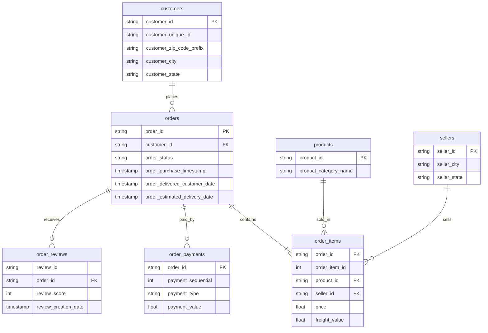

# Olist - Analyse e-commerce

Analyse du jeu de données public Olist (commerce en ligne brésilien) avec SQL (DuckDB). Données : « Brazilian E-Commerce Public Dataset by Olist » (Kaggle).

## Problématique

Olist veut augmenter son chiffre d'affaires. **Faut-il miser sur l'acquisition, la rétention ou la qualité de service ?**

## Structure du projet

| Dossier / fichier | Rôle |
|---|---|
| `data/` | Fichiers CSV bruts Olist |
| `sql/00_setup.sql` | Chargement des CSV dans DuckDB et contrôle du nombre de lignes |
| `sql/01_data_quality.sql` | Contrôles de qualité et cadrage de l'analyse |
| `sql/03_overview.sql` | CA mensuel (`payment_value`), nombre de commandes, panier moyen et variation d'un mois à l'autre |
| `sql/02_cohorts.sql` | Rétention par cohorte (mois du premier achat) et rétention moyenne à l'écart 1 et aux écarts suivants |
| `sql/04_rfm.sql` | Segmentation des clients par récence et montant, et part du CA de chaque segment |
| `sql/05_delivery_reviews.sql` | Note moyenne par tranche de retard et par État, part des commandes en retard |
| `sql/06_sellers.sql` | Classement des vendeurs par CA, test de Pareto, notes des 100 premiers vendeurs |

## Schéma des données

## 00 - Setup

`sql/00_setup.sql` crée une table DuckDB par fichier CSV avec `read_csv_auto`, puis vérifie le nombre de lignes de chaque table.

| Table | Fichier source | Lignes |
|---|---|---|
| `orders` | `olist_orders_dataset.csv` | 99 441 |
| `order_items` | `olist_order_items_dataset.csv` | 112 650 |
| `order_payments` | `olist_order_payments_dataset.csv` | 103 886 |
| `order_reviews` | `olist_order_reviews_dataset.csv` | 99 224 |
| `products` | `olist_products_dataset.csv` | 32 951 |
| `sellers` | `olist_sellers_dataset.csv` | 3 095 |
| `customers` | `olist_customers_dataset.csv` | 99 441 |

Les fichiers `olist_geolocation_dataset.csv` et `product_category_name_translation.csv` ne sont pas utilisés : ils ne sont ni chargés ni inclus dans le dépôt.

> Les chemins des CSV dans `00_setup.sql` sont relatifs (`data/olist_*_dataset.csv`) : il faut lancer DuckDB depuis le dossier `olist/`. Dans VS Code, ouvrir le dossier `olist` (File → Open Folder), puis exécuter `00_setup.sql` avant les autres fichiers.

## 01 - Qualité des données

`sql/01_data_quality.sql` regroupe les contrôles faits avant toute analyse. Chaque requête indique en commentaire le résultat attendu, qui correspond aux chiffres ci-dessous.

### Paiements (`order_payments`)

- Aucune ligne n'est dupliquée sur les cinq colonnes (`order_id`, `payment_sequential`, `payment_type`, `payment_installments`, `payment_value`).
- Une commande peut avoir plusieurs paiements (jusqu'à 29 lignes pour une même commande), donc `order_id` n'est pas unique dans cette table.
- La table couvre 99 440 commandes distinctes pour 99 441 commandes dans `orders` : une commande n'a aucun paiement. C'est une commande livrée (`bfbd0f9bdef84302105ad712db648a6c`).
- Le couple (`order_id`, `payment_sequential`) est unique : c'est la clé de la table.
- `payment_value` minimale : 0 (aucune valeur négative).
- 2 961 commandes ont plusieurs paiements.
- **Conséquence :** il faut agréger les paiements par `order_id` (`sum(payment_value)`) avant de joindre `order_payments` à `orders`, sinon les commandes à paiements multiples sont comptées plusieurs fois.

### Articles (`order_items`)

- Le couple (`order_id`, `order_item_id`) est unique : aucune ligne dupliquée.
- 112 650 lignes pour 98 666 commandes, soit 13 984 lignes de plus que de commandes. 9 803 commandes contiennent plus d'un article.
- 775 commandes de `orders` n'ont aucun article dans `order_items` : 603 `unavailable`, 164 `canceled`, 5 `created`, 2 `invoiced` et 1 `shipped`. Aucune n'est livrée.
- **Conséquence :** il faut agréger les articles par `order_id` avant de joindre `order_items` à `orders`, sinon une commande multi-articles est comptée plusieurs fois (le calcul du revenu le fait déjà avec un `group by oi.order_id`).

### Avis (`order_reviews`)

- 99 224 lignes pour 98 673 commandes distinctes, soit 551 lignes de plus que de commandes. Elles viennent de 547 commandes qui ont plusieurs avis.
- 768 commandes de `orders` n'ont aucun avis.
- **Conséquence :** pour l'analyse livraison et avis, il faut ne garder qu'un avis par commande (ou en faire la moyenne) avant de joindre `order_reviews` à `orders`. Il faut aussi accepter qu'environ 0,8 % des commandes n'aient pas de note.

### Clients (`customers`)

- 99 441 `customer_id` pour seulement 96 096 `customer_unique_id`. Un même client reçoit un nouveau `customer_id` à chaque commande.
- **Règle à retenir :** toute analyse de rétention, de cohortes ou de RFM doit utiliser `customer_unique_id`. Avec `customer_id`, tous les clients paraîtraient distincts.
- Parmi les clients ayant une commande livrée : 2 801 clients récurrents sur 93 358, soit 3,00 %.

### Commandes (`orders`)

- 97,02 % des commandes sont au statut `delivered` (96 478 sur 99 441). Les autres statuts (`shipped`, `canceled`, `unavailable`, `invoiced`, ...) pèsent chacun 1,11 % ou moins.
- Les commandes de fin 2016 sont très peu nombreuses (4, 324 et 1 commandes sur trois mois) : l'analyse démarre en janvier 2017.
- 8 commandes livrées n'ont pas de date de livraison, et aucune n'est livrée avant son achat. L'analyse livraison et avis les exclut (filtre `order_delivered_customer_date is not null`).
- **Période d'analyse retenue :** du 1er janvier 2017 au 31 août 2018, sur les commandes `delivered`.

### Revenu total sur la période

Trois définitions du revenu ont été calculées, sur les commandes livrées de la période :

| Définition | Table | Revenu total |
|---|---|---|
| Prix des articles | `order_items` (`price`) | 13 181 027,13 |
| Prix + frais de port | `order_items` (`price + freight_value`) | 15 373 120,01 |
| Paiements | `order_payments` (`payment_value`) | 15 375 875,44 |

Les frais de port expliquent l'essentiel de l'écart entre les deux premières lignes. Le revenu basé sur les paiements dépasse de 2 755,43 le revenu prix + frais de port, soit seulement 0,02 % du total : les deux définitions sont pratiquement équivalentes.

### Décisions

- **Chiffre d'affaires :** il est défini par `payment_value` (somme des paiements des commandes livrées entre le 1er janvier 2017 et le 31 août 2018).
- **Paiements à 0 :** ils sont conservés, car ils sont très rares et n'ont aucun effet sur le CA, qui est une somme.
- **Clients :** les analyses utilisent `customer_unique_id`.
- **Jointures :** les tables `order_payments`, `order_items` et `order_reviews` sont agrégées par `order_id` avant d'être jointes à `orders`.

## Résultats

### Comment évolue le CA mensuel ?

Le CA mensuel passe de 0,13 M en janvier 2017 à un pic de 1,15 M en novembre 2017, puis plafonne entre 0,99 et 1,13 M depuis mars 2018. *Source : `sql/03_overview.sql`.*

### Les clients reviennent-ils ?

Jamais plus de 0,72 % d'une cohorte ne rachète un mois donné ; à l'écart 1, la rétention moyenne (0,48 %) est environ deux fois supérieure à celle des mois suivants (0,23 %). *Source : `sql/02_cohorts.sql`.*

### Qui sont les clients à forte valeur ?

Le segment « à risque » (forte valeur, dernier achat ancien) pèse 29,22 % du CA, presque autant que les champions (30,61 %). *Source : `sql/04_rfm.sql`.*

### Les retards de livraison font-ils baisser les notes ?

| Livraison par rapport à la date estimée | Commandes avec avis | Note moyenne |
|---|---|---|
| Plus de 7 jours d'avance | 70 673 | 4,32 |
| 0 à 7 jours d'avance | 18 509 | 4,19 |
| 1 à 3 jours de retard | 1 851 | 3,29 |
| 4 à 7 jours de retard | 1 748 | 2,11 |
| Plus de 7 jours de retard | 2 779 | 1,70 |

La note moyenne tombe de 4,32/5 pour les commandes livrées avec plus de 7 jours d'avance à 1,70/5 pour celles livrées avec plus de 7 jours de retard. *Source : `sql/05_delivery_reviews.sql`.*

### Le CA dépend-il de quelques vendeurs ?

531 vendeurs sur 2 945 (18 %) font 80 % du CA, une concentration classique, mais aucun vendeur ne pèse plus de 1,72 % : le risque de dépendance à un vendeur unique est faible. *Source : `sql/06_sellers.sql`.*

## Recommandations

**Faut-il miser sur l'acquisition, la rétention ou la qualité de service ?** D'après les analyses, la priorité est la **rétention**, puis la **qualité de service**. L'acquisition ne doit pas augmenter tant que son coût n'est pas connu. Les analyses sont descriptives : elles montrent des écarts, pas des causes. Chaque chiffre ci-dessous vient d'une requête du dossier `sql/` ou s'en déduit directement (97 % = 100 % − 3,00 % de clients récurrents ; « environ 160 R$ » arrondit la fourchette de 155 à 167 R$ par commande de `sql/03_overview.sql`).

1. **Rétention : relancer les clients le mois suivant leur premier achat.** 97 % des clients n'achètent qu'une fois, et seulement 0,48 % d'une cohorte rachète le mois suivant (écart 1). Les mois d'après font environ deux fois moins bien : 0,23 % par mois en moyenne (cohorte d'août 2018 exclue, et seuls les écarts déjà observables sont comptés).
   *Action :* envoyer une offre de second achat le mois suivant la première commande, et la tester contre un groupe témoin. L'objectif est de dépasser 0,48 % à l'écart 1. Cibler aussi le segment « à risque » (14 491 clients, 29,22 % du CA : forte valeur, dernier achat ancien).

2. **Qualité de service : fiabiliser les délais annoncés.** Les commandes livrées avec plus de 7 jours de retard ont une note moyenne de 1,70/5, contre 4,32/5 pour celles livrées avec plus de 7 jours d'avance. Parmi les 95 560 commandes livrées qui ont un avis, 6,7 % (6 378) arrivent en retard.
   *Action :* recalculer la date de livraison estimée affichée au client, État par État, en commençant par le Maranhão (17,21 % de commandes en retard, note de 3,83/5) et le Ceará (13,73 %). Prévenir le client dès qu'un retard est prévisible. L'analyse montre l'effet des retards sur la note, pas sur le réachat : il faut le vérifier avant de chiffrer un gain de CA.

3. **Qualité de service : suivre la note des gros vendeurs.** 18 % des vendeurs (531 sur 2 945) font 80 % du CA, donc leur qualité pèse plus que celle des autres. Parmi les 100 premiers, le vendeur de rang 59 est à 2,79/5 (38 991 de CA) et celui de rang 5 à 3,50/5 (186 570 de CA), pour une note moyenne de 4,15 sur ces 100 vendeurs (moyenne des notes par vendeur ; 4,12 si l'on pondère par le nombre de commandes).
   *Action :* suivre chaque mois la note des 531 vendeurs qui font 80 % du CA et ouvrir un plan d'action sous un seuil à fixer. Le seuil de 3,5/5 n'est qu'une hypothèse de départ, à ajuster selon la distribution des notes.

4. **Acquisition : ne pas augmenter les budgets sans connaître le coût d'acquisition.** Le CA mensuel stagne entre 0,99 et 1,13 M depuis mars 2018, après le pic de novembre 2017 (1,15 M). Une commande rapporte en moyenne 155 à 167 R$ depuis mars 2018, et comme 97 % des clients n'achètent qu'une fois, un nouveau client vaut en pratique une seule commande.
   *Action :* mesurer le coût d'acquisition par client (absent de ces données) et ne le financer que s'il reste nettement inférieur à environ 160 R$ de CA par commande.

**Limites.** Le CA n'est pas la marge. La rétention mesure la part d'une cohorte qui achète un mois donné, pas une part cumulée. Quand une commande contient des articles de plusieurs vendeurs, son avis compte pour chacun d'eux.